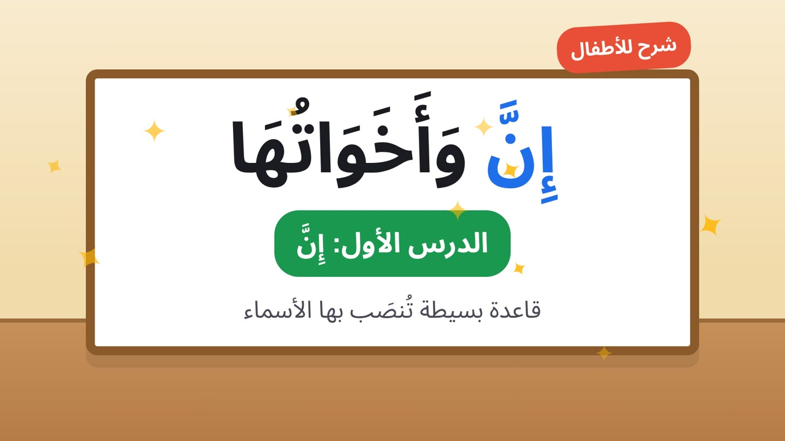

# 📚 Studio My Channel — YouTube & TikTok

## 📡 Kanäle

- **YouTube**: [`@MadrasatiArabic`](https://www.youtube.com/@%D9%85%D8%AF%D8%B1%D8%B3%D8%AA%D9%8A-%D8%A7%D9%84%D8%B9%D8%B1%D8%A8%D9%86%D9%8A%D8%A9)  (Madrasati Arabic)
- **TikTok**: [`@arbic.skool`](https://www.tiktok.com/@arbic.skool)

---

## �1 Organisatorische Struktur

```
AI vedio/
├ ├── arabic-educational-skills/     # Skills + references + scripts (11 Claude skills)
├ ├── youtube/
│   │   ├── long-form/               # 16:9 Videos (3-12 min)
│   │   ├── shorts/                  # YouTube Shorts (9:16, ≤60s)
│   │   ├── metadata/                # Publikationsdaten (SEO, Tags, Beschreibung)
│   │   └── thumbnails/              # Thumbnails (1280×720)
├ ├── tiktok/
│   │   ├── shorts/                  # TikTok Videos (9:16, ≤60s)
│   │   ├── metadata/                # Publikationsdaten
│   │   └── covers/                  # Covers (1080×1920)
├ ├── projects/                      # Video Ordner (master-script + config)
├ ├── assets/
│   │   ├── branding/                # Logo, intro, outro
│   │   └── characters/              # Character Cards
└ └── exports/                       # Enddateien (MP4, SRT, metadata)
```

---

## ⚙️ Workflow (gemäß arabic-educational-skills/SKILL.md)

1. **Gate A**: Lektionenanalyse + Ideenzulassung
2. **Gate B**: Schreiben von `master-script.json/md` → `validate_script.py`
3. **Gate C**: Erstellen eines Musterszenen → Genehmigung
4. **Production**: Assets → Animation → Stimme → Bearbeitung → Export → `check_output.py`

---

## 📦 Abhängigkeiten

- Python 3.x
- ffmpeg + ffprobe (im PATH)
- jsonschema (optional: `pip install jsonschema`)
- Node.js >= 18 (für youtube-automation-agent)

---

## 🛠️ Skripte

| Skript | Funktion |
|---|---|
| `validate_script.py` | Schemavalidierung + Semantik + Diacritics + Hash |
| `voice_pack.py` | Aufzeichnungszeilen für Generierung erstellen |
| `mux_audio.py` | Audiounterstützung auf Video |
| `check_output.py` | Technische Prüfung der Enddatei (ffprobe + SRT) |

---

## 💡 Hinweise

- ✅ grammar-bank.md benötigt Lehrerüberprüfung vor der Veröffentlichung
- 🔤 Arabischer Text ist programmiert (HTML/SVG) — verlassen Sie sich nicht auf Bildgeneratoren
- 🏷️ Jede Szene benötigt `id` und `hash` (berechnet mit `validate_script.py --update-hashes`)
- 🛡️ `.env` ist in `.gitignore` für Sicherheit gespeichert
- 📦 `.gitignore` deckt `node_modules/`, `.env`, `data/`, `uploads/` ab

---

## 🛠️ Projekt-Tools

Siehe tools/README.md — 3 hinzugefügte Repositorys:

| Repository | Beschreibung |
|---|---|
| `tools/elephant-goldfish-model/` (EGM) | Plugin für Claude Code/Codex/Gemini für Software-Design und Code-Review |
| `tools/youtube-agent-skill/` | 11 Claude-Fähigkeiten für YouTube-Management (Skripte, Hooks, Verpackung, Retention, Shorts, Viral, SEO, Kapitel, Audit) |
| `tools/youtube-automation-agent/` | Selbstgehostete KI-Agentin, die einen YouTube-Kanal vollständig verwaltet (Forschung → Skript → Sprachausgabe → MP4 → SEO → Genehmigungsbasiertes Veröffentlichen) |

---

## 📦 Schnellinstallation

```bash
# 1. Dateien kopieren
git clone <repository-url>
cd AI\ vedio

# 2. Walkthrough ausführen (interaktive Einrichtung)
cd tools/youtube-automation-agent
npm run walkthrough

# 3. Chromium installieren
npx playwright install chromium

# 4. Server starten
npm start
#   → http://localhost:3456
```

---

## 📄 Projekt-Lizenz

MIT License — sehen Sie LICENSE für weitere Details.

---

## 🙏 Anerkennung

Besonderer Dank an Community-Mitglieder, die zu `arabic-educational-skills` und den Tools `youtube-agent-skill` und `youtube-automation-agent` beigetragen haben.

---

<p align="center">
  
</p>

<p align="center">
  <sub>Beispiel-Video-Thumbnail (1280×720)</sub>
</p>
</content>