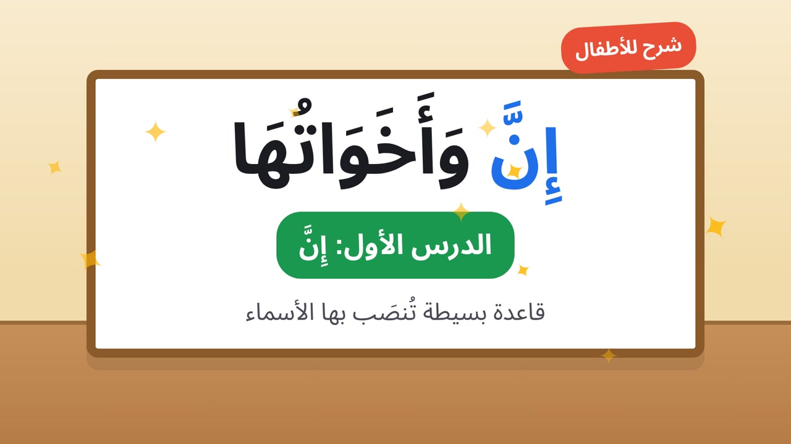

# 📚 Studio My Channel — YouTube & TikTok

## 📡 Channels

- **YouTube**: [`@MadrasatiArabic`](https://www.youtube.com/@%D9%85%D8%AF%D8%B1%D8%B3%D8%AA%D9%8A-%D8%A7%D9%84%D8%B9%D8%B1%D8%A8%D9%8A%D8%A9)  (Madrasati Arabic)
- **TikTok**: [`@arbic.skool`](https://www.tiktok.com/@arbic.skool)

---

## 📁 Organizational Structure

```
AI vedio/
├ ├── arabic-educational-skills/     # Skills + references + scripts (11 Claude skills)
├ ├── youtube/
│   │   ├── long-form/               # 16:9 Videos (3-12 min)
│   │   ├── shorts/                  # YouTube Shorts (9:16, ≤60s)
│   │   ├── metadata/                # Publication Data (SEO, tags, description)
│   │   └── thumbnails/              # Thumbnails (1280×720)
├ ├── tiktok/
│   │   ├── shorts/                  # TikTok Videos (9:16, ≤60s)
│   │   ├── metadata/                # Publication Data
│   │   └── covers/                  # Covers (1080×1920)
├ ├── projects/                      # Video Folders (master-script + config)
├ ├── assets/
│   │   ├── branding/                # Logo, intro, outro
│   │   └── characters/              # Character Cards
└ └── exports/                       # Final Files (MP4, SRT, metadata)
```

---

## ⚙️ Workflow (according to arabic-educational-skills/SKILL.md)

1. **Gate A**: Lesson analysis + Idea approval
2. **Gate B**: Writing `master-script.json/md` → `validate_script.py`
3. **Gate C**: Producing Sample Scene → Approval
4. **Production**: Assets → Animation → Voice → Editing → Export → `check_output.py`

---

## 📦 Dependencies

- Python 3.x
- ffmpeg + ffprobe (in PATH)
- jsonschema (optional: `pip install jsonschema`)
- Node.js >= 18 (for youtube-automation-agent)

---

## 🛠️ Scripts

| Script | Function |
|---|---|
| `validate_script.py` | Schema validation + semantics + diacritics + hash |
| `voice_pack.py` | Building recording lines for generation |
| `mux_audio.py` | Audio synchronization on video |
| `check_output.py` | Technical check of final file (ffprobe + SRT) |

---

## 💡 Notes

- ✅ grammar-bank.md needs teacher review before publishing
- 🔤 Arabic text is programmed (HTML/SVG) — do not rely on image generators
- 🏷️ Each scene needs `id` and `hash` (calculated with `validate_script.py --update-hashes`)
- 🛡️ `.env` stored in `.gitignore` for security
- 📦 `.gitignore` covers `node_modules/`, `.env`, `data/`, `uploads/`

---

## 🛠️ Project Tools

See tools/README.md — 3 added repositories:

| Repository | Description |
|---|---|
| `tools/elephant-goldfish-model/` (EGM) | Plugin for Claude Code/Codex/Gemini for software design and review |
| `tools/youtube-agent-skill/` | 11 Claude skills for YouTube management (scripts, hooks, packaging, retention, shorts, viral, seo, chapters, audit) |
| `tools/youtube-automation-agent/` | Self-hosted AI agent that runs a YouTube channel end-to-end (Research → Script → Voiceover → MP4 → SEO → Approval-based Publish) |

---

## 📦 Quick Installation

```bash
# 1. Copy files
git clone <repository-url>
cd AI\ vedio

# 2. Run walkthrough (interactive setup)
cd tools/youtube-automation-agent
npm run walkthrough

# 3. Install Chromium
npx playwright install chromium

# 4. Start server
npm start
#   → http://localhost:3456
```

---

## 📄 Project License

MIT License — see LICENSE for more details.

---

## 🙏 Acknowledgments

Special thanks to community members who contributed to `arabic-educational-skills` and the `youtube-agent-skill` and `youtube-automation-agent` tools.

---

<p align="center">
  
</p>

<p align="center">
  <sub>Sample Video Thumbnail (1280×720)</sub>
</p>
</content>