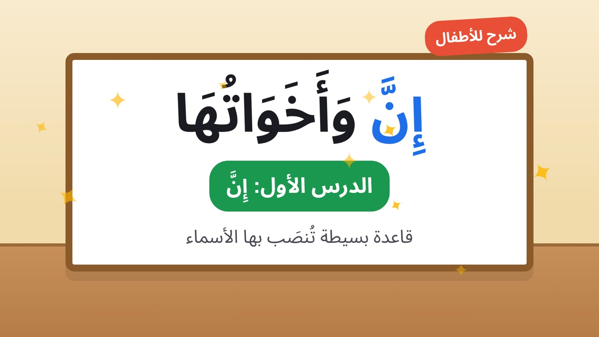

# 📚 استوديو قناتي — YouTube & TikTok

استوديو إنتاج فيديوهات تعليمية باللغة العربية (نحو، صرف، إملاء، بلاغة، ...) — من تطوير agenteer.

---

## 📡 القنوات

- **YouTube**: [`@مدرب_العربية`](https://www.youtube.com/@%D9%85%D8%AF%D8%B1%D8%B3%D8%AA%D9%8A-%D8%A7%D9%84%D8%B9%D8%B1%D8%A8%D9%8A%D8%A9)  (مدرستي العربية)
- **TikTok**: [`@arbic.skool`](https://www.tiktok.com/@arbic.skool)

---

## 📁 الهيكل التنظيمي

```
AI vedio/
├ ├── arabic-educational-skills/     # Skills + references + scripts (11 مهارة Claude)
├ ├── youtube/
│   │   ├── long-form/               # فيديوهات 16:9 (3-12 min)
│   │   ├── shorts/                  # YouTube Shorts (9:16, ≤60s)
│   │   ├── metadata/                # بيانات النشر (SEO, tags, description)
│   │   └── thumbnails/              # صور مصغّرة (1280×720)
├ ├── tiktok/
│   │   ├── shorts/                  # مقاطع تيك توك (9:16, ≤60s)
│   │   ├── metadata/                # بيانات النشر
│   │   └── covers/                  # صور الغلاف (1080×1920)
├ ├── projects/                      # مجلد لكل فيديو (master-script + config)
├ ├── assets/
│   │   ├── branding/                # شعار، intro، outro
│   │   └── characters/              # بطاقات الشخصيات
└ └── exports/                       # الملفات النهائية (MP4, SRT,metadata)
```

---

## ⚙️ سير العمل (حسب arabic-educational-skills/SKILL.md)

1. **بوابة أ**: تحليل الدرس + اعتماد الفكرة
2. **بوابة ب**: كتابة `master-script.json/md` → `validate_script.py`
3. **بوابة ج**: إنتاج مشهد تجريبي → اعتماد
4. **الإنتاج**: أصول → تحريك → صوت → مونتاج → تصدير → `check_output.py`

---

## 📦 المتطلبات (Dependencies)

- Python 3.x
- ffmpeg + ffprobe (في PATH)
- jsonschema (اختياري: `pip install jsonschema`)
- Node.js >= 18 (لـ youtube-automation-agent)

---

## 🛠️ السكربتات

| السكربت | الوظيفة |
|---|---|
| `validate_script.py` | تحقق من السكيما + دلالات + تشكيل + hash |
| `voice_pack.py` | بناء قائمة أسطر للتسجيل/التوليد |
| `mux_audio.py` | تركيب الصوت على الفيديو |
| `check_output.py` | فحص تقني للملف النهائي (ffprobe + SRT) |

---

## 💡 ملاحظات

- ✅ grammar-bank.md يحتاج مراجعة معلم قبل النشر
- 🔤 النص العربي يُركَّب برمجياً (HTML/SVG) — لا يُعتمد على مولدات الصور
- 🏷️ كل مشهد يحتاج `id` و `hash` (يُحسب بـ `validate_script.py --update-hashes`)
- 🛡️ `.env` مخزن في `.gitignore` للأمان
- 📦 `.gitignore` يغطي `node_modules/`, `.env`, `data/`, `uploads/`

---

## 🛠️ أدوات المشروع (Tools)

انظر tools/README.md — 3 مستودعات مضافة:

| المستودع | الوصف |
|---|---|
| `tools/elephant-goldfish-model/` (EGM) | إضافة (plugin) لـ Claude Code/Codex/Gemini لتصميم ومراجعة البرمجيات |
| `tools/youtube-agent-skill/` | 11 مهارة Claude لإدارة قناة YouTube (scripts, hooks, packaging, retention, shorts, viral, seo, chapters, audit) |
| `tools/youtube-automation-agent/` | وكيل AI مُستضاف ذاتياً (self-hosted) يُشغّل قناة YouTube من البداية للنهاية (بحث → سيناريو → تعليق صوتي → MP4 → SEO → نشر بعد موافقة) |

---

## 📦 التثبيت السريع

```bash
# 1. انسخ الملفات
git clone <repository-url>
cd AI\ vedio

# 2. شغل الـ walkthrough (إعداد تفاعلي)
cd tools/youtube-automation-agent
npm run walkthrough

# 3. سبح Chromium
npx playwright install chromium

# 4. شغل الخادم
npm start
#   → http://localhost:3456
```

---

## 📄 ترخيص المشروع

MIT License — انظر LICENSE للمزيد من التفاصيل.

---

## 🙏 الامتنان

شكر خاص لأعضاء المجتمع الذين ساهموا في `arabic-educational-skills` وأدوات `youtube-agent-skill` و `youtube-automation-agent`.

---

<p align="center">
  
</p>

<p align="center">
  <sub>مثال لغلاف فيديو (1280×720)</sub>
</p>
</content>